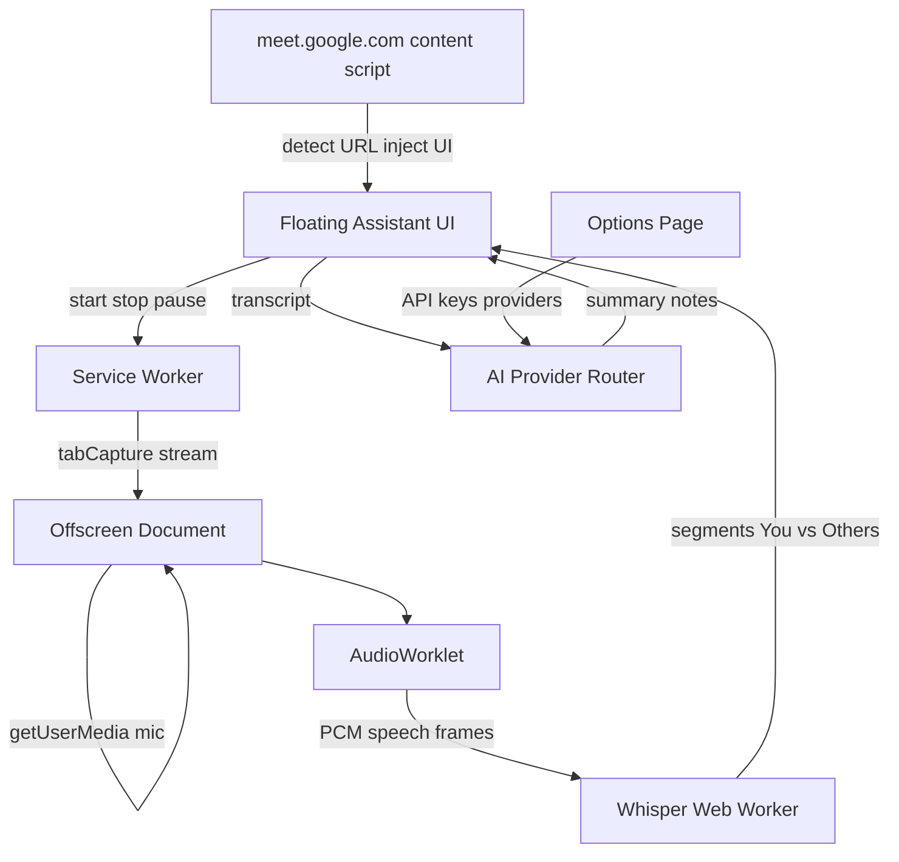

# Minimal Chrome Meeting Assistant MVP

## Scope

Chrome extension only. Google Meet first. No login, dashboard, backend accounts, or cloud storage.

Reusable ideas from [`note.html`](note.html): session timer, mic capture patterns, download/export Blobs. Do **not** port the full-page dashboard UI.

## Stack decisions

- **Transcription:** Transformers.js + Whisper Tiny (default), Base selectable in settings
- **Summary / notes:** remote AI via provider API keys (not a local LLM in v1)
- **UI:** React + Vite + TypeScript, CRXJS or `@crxjs/vite-plugin` for MV3 packaging
- **Audio:** Offscreen document + AudioWorklet → 16 kHz mono PCM → VAD → Whisper worker

## Architecture



## Extension layout

```text
extension/
  manifest.json
  src/
    background/service-worker.ts
    content/meet-detector.ts
    content/floating-app/     # React floating panel
    offscreen/audio-engine.ts
    offscreen/worklets/pcm-vad-processor.ts
    workers/whisper.worker.ts
    ai/providers/             # OpenAI, Anthropic, Gemini, Copilot, Grok, Local
    ai/summarize.ts
    options/                  # API keys + Whisper model size
    shared/types.ts
    shared/storage.ts
```

## Manifest permissions

- `tabCapture`, `offscreen`, `storage`, `activeTab`
- Host matches: `https://meet.google.com/*` only for content script
- Optional host permissions for AI APIs (openai, anthropic, google, x.ai, Azure/Copilot, user local URL via optional permissions or broad `https://*/*` only if required for Local model)

## Feature plan

### 1. Meet detection (invisible elsewhere)

Content script matches `meet.google.com/*` only. On load: read URL, set status `Google Meet detected`, inject floating button. No injection on other sites.

Meeting metadata (best-effort, DOM-light):

- provider: `Google Meet`
- url: current href
- startTime: when assistant starts
- title/participants: optional scrape, never required

### 2. Floating window

Draggable, resizable, collapsible, high z-index, position persisted in `chrome.storage.local`.

States: collapsed `🤖 ●` → idle panel → listening (live transcript, timer, Pause/Stop) → Summary / Notes tabs → copy/download.

### 3. Audio capture (streams stay separate)

On **Start Assistant**:

1. Service worker creates offscreen doc and starts `chrome.tabCapture` → `tabAudio`
2. Offscreen requests `getUserMedia({ audio: true })` → `microphoneAudio`
3. Do **not** mix for transcription; tag frames as `source: "mic" | "tab"`

Mic segments label as **You**; tab segments as **Other speakers** (no full diarization in MVP).

### 4. AudioWorklet + VAD

Worklet resamples to 16 kHz mono PCM, runs simple energy/VAD, posts only speech frames to the Whisper worker. Silence is dropped.

### 5. Whisper worker

Never run Whisper in the floating UI thread. Worker loads Transformers.js + `Xenova/whisper-tiny` (or base). Queue speech chunks; emit `{ id, start, end, text, source }` segments to the UI.

### 6. AI provider settings (summary / notes)

Options page with provider selector (**6 providers**):

| Provider | Config |
|---|---|
| OpenAI | API key (+ model default `gpt-4o-mini`) |
| Anthropic | API key (+ model default `claude-3-5-haiku`) |
| Gemini | API key |
| Copilot | API key (+ endpoint / deployment if Azure-style) |
| Grok | API key (xAI) |
| Local model | Base URL + API key (OpenAI-compatible `/v1/chat/completions`) |

Keys stored in `chrome.storage.local` (never committed). Shared `LLMProvider` interface:

```ts
chat({ system, user }): Promise<string>
```

On Stop (or Summary tab): send transcript → structured JSON: executive summary, decisions, action items, notes. Render in UI; allow fallback “no key configured” message.

### 7. Export

Copy to clipboard + download:

- `transcript.txt` / `.md`
- `summary.md`
- `meeting.json` (provider, url, start/end, segments, summary)

## Explicit non-goals (this MVP)

Login, signup, dashboard, profiles, backend accounts, subscriptions, teams, Zoom/Teams detection, cloud storage, speaker enrollment, video recording.

## Implementation order

1. Scaffold Vite + CRXJS MV3 extension with Meet-only content script + empty floating UI
2. Floating panel UX (drag, resize, collapse, persist position)
3. Offscreen tabCapture + mic (separate streams) + AudioWorklet/VAD
4. Whisper worker + live transcript UI
5. Options page + 6 AI providers + summarize/notes
6. Copy/download export
7. Smoke-test on a real Meet URL; document load unpacked + permissions

## Key risk notes

- MV3: tab audio must live in **offscreen**; UI only displays results
- Whisper Tiny is CPU-heavy; VAD + short chunks are required for usable live feel
- Local model URL may need optional host permission at runtime
- Google Meet DOM for title/participants is best-effort only
